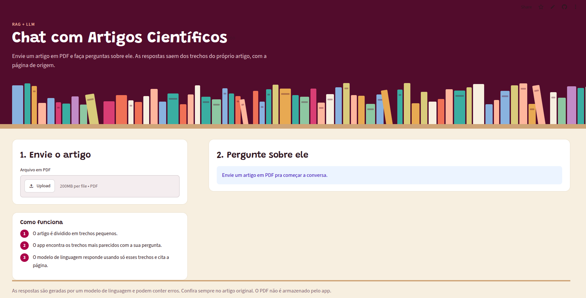
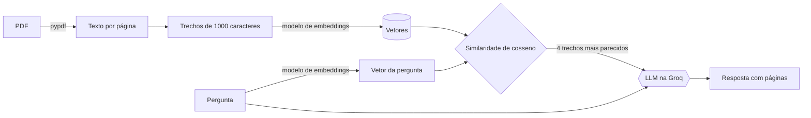

# Chat com artigos científicos

Você envia um artigo em PDF e faz perguntas sobre ele em português. O app procura os trechos do artigo que têm a ver com a pergunta e um modelo de linguagem responde usando só esses trechos, dizendo de que página tirou cada informação.

Essa técnica se chama RAG (geração aumentada por recuperação). Fiz porque passei um ano lendo artigo de bioinformática na iniciação científica e queria um jeito mais rápido de achar o que eu precisava dentro deles.

## Arquitetura



O artigo é dividido e transformado em vetores uma vez, quando é enviado. A cada pergunta, o app só calcula o vetor da pergunta e compara com os que já existem.

## Estrutura

```
├── rag.py                  lê o PDF, divide em trechos, cria os vetores e faz a busca
├── llm.py                  prompt e chamada à API da Groq
├── app.py                  app em Streamlit
├── style.css               visual
├── templates/              HTML do banner, do "como funciona" e do rodapé
├── .streamlit/config.toml  cores do tema
└── requirements.txt
```

## Decisões

- O modelo de embeddings é multilíngue, então uma pergunta em português encontra trechos de um artigo em inglês.
- Os trechos têm 200 caracteres de sobreposição, pra uma ideia não ser cortada no meio.
- A busca é feita com NumPy, sem banco vetorial. Pra um artigo só, são poucas centenas de vetores e não precisa de mais que isso.
- O prompt manda o modelo responder só com o que está nos trechos e avisar quando não encontrar.
- O app mostra os trechos usados em cada resposta, pra dar pra conferir.

## Como rodar

Precisa de Python 3 e de uma chave gratuita da Groq (console.groq.com).

```bash
python3 -m venv venv
source venv/bin/activate
pip install -r requirements.txt
export GROQ_API_KEY="sua-chave"
streamlit run app.py
```

Na primeira vez o modelo de embeddings é baixado (uns 220 MB), então demora um pouco mais.

## Limitações

Cada pergunta é respondida sozinha, sem lembrar das anteriores. PDF escaneado (imagem) não funciona, porque não tem texto pra extrair. Tabelas e fórmulas costumam sair bagunçadas na extração. E se a busca trouxer os trechos errados, a resposta sai incompleta, por isso os trechos ficam visíveis.
